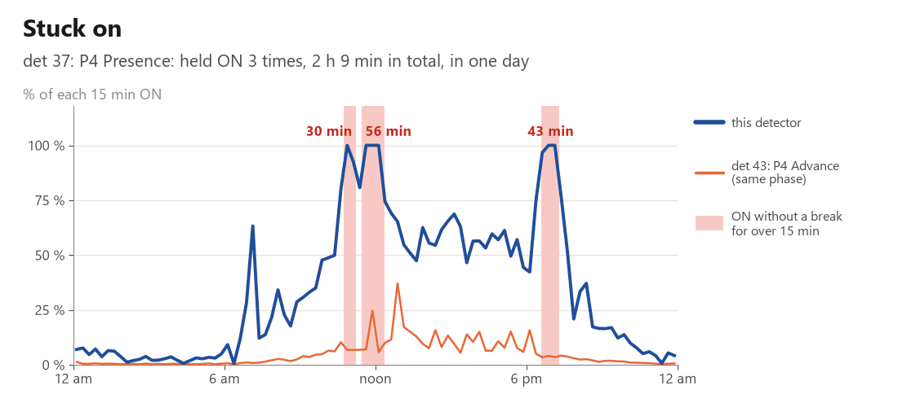
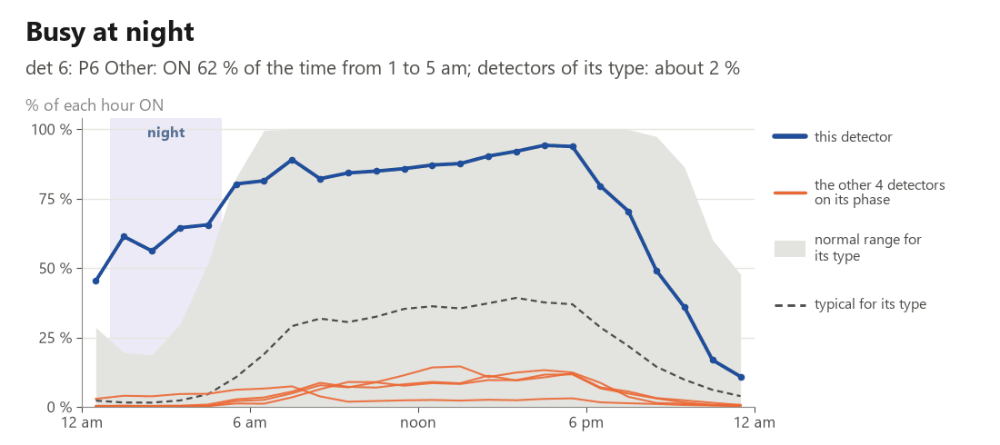

# atspm-detector

Give it a signal controller's hi-res event log; for every vehicle detector it returns the **phase**, **function**,
**lanes**, **setback** from the stop bar and **health**. No cabinet print needed: the answers come from how each
detector behaves. Use it to **build** a signal's ATSPM detector configuration, or to **check** the one you have.

* **Tested on 115 signals it never trained on:** phase right for **98.0 %** of detectors, function **91.7 %**
  (30 minutes or more of log).
* **More accurate than hand-labled configuration:** phase wrong on 1.3 % of detectors, against 2.6 % by hand.
* **Fast and light:** one second per signal on CPU.

**Contents:** [Detector functions](#detector-functions) · [Install](#install) · [Usage](#usage) · [Input](#input) ·
[How much data](#how-much-data) · [How it works](#how-it-works) · [Accuracy](#accuracy) · [Detector
health](#detector-health) · [Pedestrian push-button health](#pedestrian-push-button-health) · [Findings and status
tables](#findings-and-status-tables) · [Incremental health](#incremental-health) · [Which phases each ped input
calls](#which-phases-each-ped-input-calls) · [License](#license)

## Detector functions

| Function | ATSPM | What it is |
|---|---|---|
| Presence | yes | Stop-bar presence zone. The presence zones used in training were about 20 ft long at the stop bar. |
| Advance | yes | Advance count zone, upstream. Single lane or spanning several lanes. |
| Count | yes | Stop-bar count zone. Usually set to pulse, one per lane. |
| Yellow_Red | yes | At the stop bar; may span several lanes. Configure it in the field with a 5 mph speed threshold. |
| Mid | no | Zone between the advance and the stop bar. A class of its own because it helps the model. |
| Bike | no | Bicycle detection zone. |
| Other | no | Everything else that drives operations but is not an ATSPM zone. |

## Install

```bash
pip install atspm-detector   # Python 3.11 or newer (tested to 3.14); DuckDB 2.0 or newer
```

## Usage

```python
import pandas as pd
from atspm_detector import predict

events = pd.read_csv("events.csv")   # or pd.read_parquet (needs pyarrow)
events.head()
```

```text
                               DeviceId                Timestamp  EventId  Parameter
0  d2d0de72-c8aa-45ca-ae1a-8fc626c5afc9  2026-10-06 12:00:00.000      150          7
1  d2d0de72-c8aa-45ca-ae1a-8fc626c5afc9  2026-10-06 12:00:00.000      320          0
2  d2d0de72-c8aa-45ca-ae1a-8fc626c5afc9  2026-10-06 12:00:00.000      318          3
3  d2d0de72-c8aa-45ca-ae1a-8fc626c5afc9  2026-10-06 12:00:00.000      316        120
4  d2d0de72-c8aa-45ca-ae1a-8fc626c5afc9  2026-10-06 12:00:00.600       13          6
```

```python
results = predict(events)
results[["Detector", "phase_pred", "phase_prob", "function_pred", "function_prob",
         "lanes", "distance_ft", "health_status"]].round(2).head()
```

```text
   Detector  phase_pred  phase_prob function_pred  function_prob lanes  distance_ft    health_status
0         2           2        0.99       Advance           0.90     2        164.0               ok
1         3           2        1.00       Advance           0.64   1,2        153.0               ok
2         4           2        1.00      Presence           0.40   1,2          0.0               ok
3         5           2        1.00       Advance           0.53     1        152.0               ok
4         6        <NA>         NaN           NaN            NaN   NaN          NaN  not_enough_data
```

From the bundled 30-minute sample; detector 6 had one actuation, too few to judge. One row per detector; main columns:

| Column | What |
|---|---|
| `phase_pred`, `phase_prob` | phase and its probability (`phase_2nd`, `phase_2nd_prob`: runner-up) |
| `function_pred`, `function_prob` | function (table above) and its probability |
| `lanes`, `phase_n_lanes` | lane(s) the detector covers, number of lanes on its phase |
| `distance_ft`, `night_speed_mph` | setback from the stop bar (ft); typical night speed on the phase |
| `health_status` | ok / watch / suspect / bad / not_enough_data / lane_closure / timing_plan |
| `status`, `review_flag` | "ok", or why an answer is missing or weak; `True` = worth a look |

Under 5 actuations: no answer (guess in `phase_guess`, `function_guess`). `return_phases=True` also returns a phase
table; `return_findings=True` the [findings table](#findings-and-status-tables), with the reasons.

**One signal or many.** `DeviceId` separates signals. Each is processed on its own, so its answers are the same alone
or in a batch. `predict` also takes a parquet or CSV path or glob, and `start` / `end` times. To build it into an
application, see [docs/embedding.md](https://github.com/ShawnStrasser/atspm-detector/blob/main/docs/embedding.md).

**Events already in DuckDB?** `health(con, "events", "detectors")` runs vehicle and ped health on your own connection
without copying the data out and returns the [findings table](#findings-and-status-tables). Store the events sorted by
`DeviceId`, then `Timestamp`. For many signals, `health(..., workers=12)` (with `SET threads = 12`) runs the groups in
12 processes at once: same answers, about 4 times faster on a whole network (889 signals over 3 days: 1.8 min instead
of 7.3).

## Input

One row per event, standard Indiana hi-res format: `DeviceId` (any signal id), `Timestamp` (controller local time),
`EventId`, `Parameter`. Give it the whole log; unused event codes are dropped.

## How much data

| Sample length | Phase | Function | Notes |
|---|---|---|---|
| 5 minutes | 94.1 % | 86.4 % | works, but weaker; no lanes |
| 30 minutes | 97.7 % | 91.7 % | **recommended minimum**; lanes from here on |
| 1 hour | 98.0 % | 91.8 % | |
| 3 hours | 98.2 % | 92.9 % | best for phase and function (3 to 24 hours) |
| 24 hours | 98.4 % | 92.5 % | full health check |

On the 115 test signals. Health runs on any length; busy at night needs a full day, count drops, night misses and spiky
counts 3 hours; night speed needs midnight to 5 am.

## How it works

* **In:** detector on / off, signal colors and phase calls. The model never sees a phase or channel number; it scores
  each detector against every phase that turned green, from behavior alone.
* **Models:** gradient-boosted trees and a small neural network score each detector against each phase and function.
  A final step looks at the whole intersection to keep at most one detector of each ATSPM function per lane. Small
  models give lanes and setback. Health is checked last, by rules, and never changes an answer. All on the CPU with
  onnxruntime (8.5 MB of weights).

## Accuracy

Measured once, on the final model, on **115 locked signals** never used for training or tuning (30 minutes to 24 hours
of log). Phase truth: controller timing (21,341 detector samples, 113 signals). Function truth: configuration export
checked against cabinet prints (87 signals). Detectors with no actuations or no green on their phase are not scored.
All labels come from one agency; other agencies' conventions may differ.

* **Phase: 98.0 %** (95 % interval 97.0-98.9 %). Most errors are between through phases nearly always green together
  (2 and 6, 4 and 8).
* **Function: 91.7 %** (88.7-94.0 %), ATSPM errors only, excluding detectors whose label the model picked (print vs
  hand label). By true class: Advance 93.9 %, Presence 95.2 %, Count 96.6 %, Yellow_Red 89.5 %, Other 81.8 %.
* **Lanes:** lane count per phase exact for 82.5 % of phases, within one for 97.5 % (298 phases).
* **Setback:** median error 36 ft (59.9 % within 50 ft; Advance, 25 signals); 23.9 ft in cross-validation.
* **Night speed:** an approach speed, not the posted speed; two nights agree to a median of 1.5 mph.
* **Speed:** 0.8 s per signal for 30 minutes of log, 1.7 s for 24 hours; 250-400 MB of memory.

**Against hand labels** (signals not trained on): phase wrong on 1.3 % of 4,636 detectors (hand labels 2.6 %); function
off the cabinet print on about 6 % of 5,254 (hand labels 9.7 %). Where model and hand label differed, the timing backed
the model 104 times to 24, the print 398 to 177. Prints can be out of date.

**Health**, with 1.2.0's rules: flagged 14 of 20 detectors a traffic engineer judged faulty, and 3 of the 12 judged
fine. Flagged (suspect or bad) per 100 detectors: 0.7 on 30 minutes, 0.9 on 3 hours, 4.4 on 24 hours. Not
field-verified.

## Detector health

Each detector gets a status (ok, watch, suspect, bad, not enough data, lane closure, timing plan) and its findings in
plain words, judged against what is normal for its type (function x lanes x sample length), on a window from 30
minutes to 92 days (2-3 days suit a daily report). Eight checks:

1. **Stuck on**: held ON longer than its type allows, and not a queue. On 24 hours suspect from 5 to 15 minutes by
   type; bad from 10 minutes for a bike zone, 20 for Yellow_Red and a Count zone set to pulse, 30 for Advance, 35 for
   Mid, 60 for Presence and Other. A Count zone not set to pulse: on one lane suspect and bad at 36 minutes; on 2+
   lanes suspect from 12.5, bad from 24. Several detectors (not two inputs of one zone) held ON together, starting and
   ending within 5 seconds: one common failure, bad, with a note for the signal. A Count zone: also held ON in light
   traffic.
2. **Counts fall**: goes silent while its phase mates keep counting, or its hourly count drops against theirs (GEH 10
   suspect, 13 bad) while its own occupancy drops too. A whole phase dropping together, or inputs logging identical
   counts, read as silent.
3. **Misses vehicles at night**: far fewer actuations from 9 pm to 5 am than its phase mates suggest (GEH 8 suspect,
   10.5 bad). A night silence with fewer than 100 vehicles expected is suspect at most.
4. **Busy at night**: much busier from 1 to 5 am than its type, and busier than its phase mates (needs a full day);
   bad at 1.5 x its limit.
5. **Too fast / too many**: ONs closer together than vehicles can follow (under 0.8 s per lane at the stop bar,
   0.6 s elsewhere; a zone spanning 2+ lanes keeps the 1-lane limit), or more vehicles than a lane can carry (busiest
   5 minutes over 2,100 per hour per lane suspect, 2,360 bad).
6. **Spiky counts**: bursts in 10-minute counts at least 3 times its own level of the surrounding 2 hours (and GEH 5 or
   more) that its phase mates do not share: 2 in a day suspect, 3 bad. Not checked under 200 vehicles a day; under 500,
   suspect at most unless a burst is very large.
7. **No daily pattern**: counts that do not follow the day while its phase mates do; a queue zone is exempt.
8. **Counts too high**: hour by hour, far more than its share of a phase mate at that time of day on the window's days.

Bike zones get no counts-fall or night check. **Bad** = a finding past its bad limit, two kinds of evidence, or a
problem lasting 4+ hours of the day (busy at night, silent 4 h); otherwise **suspect** (a presence or other zone that
only flickers evenly with traffic stays suspect). **Watch** = borderline, or no healthy phase mate to compare with.
The limits are in `weights/health/health_limits.json` as [suspect, bad] per check and type; under about 8 hours of
data stuck on, goes silent and too many keep the 1.0 limits. With 1.2.0's rules, flagged (suspect or bad) on 755
training signals: 4.4 % of detectors on 24 hours (2.3 % suspect, 2.1 % bad), 0.9 % on 3 hours, 0.7 % on 30 minutes.
Not field-verified.

**All inputs lost:** every detector of a signal silent for an hour or more of daytime while the signal serves greens
(rack, cabinet) is one silence, also across a stretch with no log, with a note for the signal.

**Lane closures and timing plans** are reported, not counted as faults: a lane that goes near zero for an hour or more
while a detector of the same kind on its phase (or the NEMA-paired phase) takes its vehicles is a lane closure, unless
the detector has faults of its own (silences, count drops, stuck-on holds) both before and after it on the same day --
then it is part of the fault; a silence that starts and ends with a coordination pattern change follows the timing plan.

**Pulse mode** (a setting, not a failure): a presence detector whose calls nearly all last 0.2 s or less looks set to
pulse mode and is rated suspect with a "Configuration" note (never bad). Count, advance and yellow-red zones may pulse.
When the detectors table has a `configured_function` column (the agency's configured function), a detector configured
as count, advance or yellow-red is never flagged.





## Pedestrian push-button health

`health(con, "events", "detectors")` also judges every ped input when the log holds ped input events (`ped_health(con,
"events")` does the ped buttons alone), from the controller's ped events (input on / off 90 / 89, ped call 45, walk /
clearance / don't walk 21-23, ped overlap walk 67, begin green 1 and yellow 8, preempt 102 / 104 / 105 / 110 / 111),
in the [same tables](#findings-and-status-tables) with `DetectorType` = `Ped` and `Detector` = the input. Status: ok,
config_issue, suspect, bad, not_enough_data. Notes on wiring and timing come as rows with Confidence 0, not faults: a
ped overlap button, a phase on ped recall, one button wired to two inputs, a button calling two ped phases, ped calls
that waited, ped calls omitted during preemption. `config_issue` = the button works, but the controller's set-up keeps
its presses from being served (listed, not a fault). Checks, per day:

- **Stuck on** (bad): one press held 5 min or more (10 for a presence input, unbroken between any holes in the log),
  or through 3 walks, or 3 min or more through 2 walks. An ON with no OFF seen, or an OFF whose ON came before the
  window, counts only if the phase walks every cycle from that ON and not already before it: otherwise it is lost
  data. Stuck through 0 walks also carries a configuration note. Stuck-on periods at most 60 s apart read as one hold;
  a brief press between them stays in every count.
- **Long hold** (suspect): a push input ON 150-179 s through 2 walks or more, with no hole in the log.
- **Machine-regular presses** (bad): half or more of the gaps between presses the same length.
- **Never calls a walk** (config issue): 10 presses or more, and no ped call, phase walk or ped overlap walk follows.
- **Walks without presses** (suspect, bad from 2.5 logged hours): its phase's walks jump while its presses stop, for
  an hour of log or more: 8 walks an hour or more, at least 80 % of the phase's greens, 3 times what those hours of
  day brought earlier in the window, with ped calls on at most 10 % of them. It also finds a stuck ON whose ON was
  lost; recall turned on reads the same. Not on a window under about 25 hours, when another button of the signal jumps
  within 30 minutes, or under a stuck ON. Only this check reads unique presses (presses up to 15 s apart are one run,
  counted one per 15 s of its length); all others count raw presses.
- **Sustained pressing** (suspect): a day with 1,000 presses or more, at least 5 times the median of the window's
  other logged days (itself at least 20), and 5 or more 15-minute periods with 30 presses or more and at least 10 per
  walk.
- **Sudden stop** (suspect or bad): the button's longest run with no press while the signal logs, against what its own
  presses at those times of day expect, allowing for presses coming in clumps and for days differing. Flagged at a
  chance of 1 in 1,000 or less, or at zero for 24 logged hours from a button with 30 presses a day or more; bad at 1
  in 1,000 or less with bursts capped. It needs a run of 6 logged hours and 20 presses in 6 separate hours outside the
  run, so a quiet button cannot flag. A button silent for the whole window is not listed; it alerts at the onset, as
  vehicle detectors do.

A ped call that waited through 2 greens or more without a walk is a config note, never a status: not a detector
problem (one such wait reads "possible configuration issue (low confidence)"). A call placed during its phase's
running walk is served. A wait with any preemption is a note "omitted during preemption"; a preemption lasts to its
logged end (input off or exit), else up to 6 h. A call placed after the yellow that led into a green is not owed that
green.

Lost data is never a fault: a walk whose start event is missing still counts; a silence of 30 s or more in the log
ends a wait; a download without ped overlap walk events does not judge "never calls a walk". `options=`
(`ped_options=` in `health()`) switches these rules (`ped_health_duckdb.OPT`). Ped recall is read from the log alone,
never from controller settings.

Sudden stop on 161 sliding 3-day windows, about 3,080 buttons each: 6.65 flags a window (0.22 %). Ped health takes
8-27 seconds for 760-820 signals on 1-3 days. Not field-verified.

## Findings and status tables

One entry point, one layout, for vehicle detectors and ped buttons together:

```python
import duckdb
from atspm_detector import health

con = duckdb.connect("signals.duckdb")
findings = health(con, "events", "detectors", start="2026-10-20", end="2026-10-23")
findings, status = health(con, "events", "detectors", start="2026-10-20", end="2026-10-23", summary=True)
findings = health(con, "events", "detectors", ped=False)    # vehicle only
findings = health(con, "events", vehicle=False)             # ped buttons only; the same as ped_health(con, "events")
```

Ped runs when the log holds ped input events (`ped=True` always, `ped=False` never).

**Findings**: one row per finding; no row means no finding.

| Column | What |
|---|---|
| `DeviceId` | the signal |
| `DetectorType` | `Vehicle` or `Ped`. Numbers can overlap: detector 2 and ped input 2 are different things |
| `Detector` | the detector channel or ped input; empty on a note about the whole signal |
| `Start`, `End` | when, local time. A finding with no time of its own gets one row per calendar day of the window, covering that day |
| `Label` | `stuck on`, `silent`, `counts dropped`, `sudden stop`, `walks without presses`, `lane closure`, `config note`, `not_enough_data`, `borderline stuck on`, ... |
| `Confidence` | 0-1: 0.5 at the check's suspect limit, 0.8 at its bad limit, 0.4 on a borderline finding, 0 on a note or `not_enough_data`, empty on a lane closure or timing plan |
| `Detail` | the evidence, in plain words |

Set-up notes, notes about a whole signal, borderline findings and too-little-data are rows too.

**Status** (`summary=True`): one row per judged detector or button and calendar day of the window: `DeviceId`,
`DetectorType`, `Detector`, `Date`, `Status`. The rules judge the window as a whole, so every day of a window carries
the window's status.

`health_sql("events", "detectors")` gives the vehicle findings as one query to run yourself (`summary=True`: two
queries). The ped rules are partly in Python, so ped has no one-query form.

## Incremental health

Keep health up to date from chunks of events, without keeping the raw log: `atspm_detector.incremental`.

```python
import duckdb
from atspm_detector import incremental as inc

con = duckdb.connect()
inc.attach_store(con, "health.duckdb", horizon_days=3)    # a DuckDB file, kept between runs; horizon_days: how far back a verdict looks
inc.update(con, "events", "detectors", upto=run_end)      # each run, with whatever arrived, in any order
r = inc.judge(con, "detectors", summary=True)             # when a verdict is wanted: r.findings, r.status
inc.detach_store(con)
```

- **Same answers.** Judged at T on events from T - horizon on, `judge` equals `health(start=T - horizon, end=T,
  bin_origin="clock", summary=True)`, however the events were cut into updates. With events from before the window
  too, only what crosses its start differs: a hold that began earlier keeps its true start, which a fresh `health()`
  of the window cannot see.
- `update` writes everything in one transaction: a failure leaves the store as it was, and repeating an update changes
  nothing. Pass `upto` (the end of the time the run covers) on a live feed: an event stamped later is held back and
  counted in `events_after_upto`. A row at or before its signal's last processed event is late: counted in
  `events_late`, not processed.
- `judge(end=...)` must be on a quarter-hour after every processed event; a window starting before the store's trim is
  refused. `workers=N` runs the vehicle groups in N processes, on a copy of the store's rows.
- `judge(outputs=("tables", "15min"))` adds `r.q15`: each finding of a suspect or bad detector or button, one row per
  quarter-hour since the previous judge. `"active"` adds `r.active` (provisional, confirmed, cleared) and keeps it in
  the store; it adds no health rule and has not been reviewed.
- `rebuild(con, raw_events, detectors, devices=[...])` replaces what the store holds on those signals with a fresh
  extraction, in one transaction (late data, a detector's phase changed).
- `trim(con, compact=True)` also merges the stored rows (`update` already trims).
- `export_store(con, folder)` carries a store across DuckDB versions, through parquet: on the new version,
  `attach_store` a new file, then `import_store(new_con, folder)`.
- A store written by an incompatible version of the package is refused with a clear message. Start a new one and
  rebuild it from raw events.

### Health in time bins

`judge(outputs=("tables", "bins"), bin_minutes=15)` adds `r.bins`: one row per bin per problem (`TimeStamp`,
`DeviceId`, `DetectorType`, `Detector`, `Label`, `Score`); no row = no problem found. `health_bins(con, "events",
"detectors", start, end)` gives the same with no store, judging once a day (`every="h"`: once an hour).

- **Past rows never change.** Each judge gives the bins since the one before and, with a past `TimeStamp`, any problem
  it is the first to find in a bin of its window already released, unless that bin, detector and label has a row. The
  same judge times give the same rows, however the events were cut.
- **`Score`** is how much of the bin was failing: about 1 for a complete failure over the whole bin, 0.5 for half a
  bin of it. Problems at one moment share its worst value, so the rows of a bin add up to at most 1; a late row in a
  bin already full has `Score` 0. With 15-minute bins, the sum of `Score` / 4 is the hours of complete failure.
- Borderline findings and notes have no rows; not enough data has one row a day with an empty `Score`.
- **Stuck for longer than the window.** A button or detector a judge rated stuck ON stays in the store for as long as
  it stays on, past the horizon and the trim, and keeps its bins until its next event (an OFF followed by an ON within
  60 s does not end a button's); no bin while its signal logs nothing (a button: while its phase walks nothing).
  `health()` and `health_bins()` know no ON before their window.

For a dashboard, the plain average of a detector over a period is its sum of `Score` divided by the bins of the period
(288 in 3 days, 672 in 7), not by its rows. An average dilutes a short failure.

| Plain average of `Score` | Good | Suspect | Bad |
|---|---|---|---|
| Vehicle detector, 3 days | under 0.2 % | to under 2 % | from 2 % |
| Vehicle detector, 7 days | under 0.1 % | to under 1 % | from 1 % |
| Ped button, 3 days | under 0.05 % | to under 0.5 % | from 0.5 % |
| Ped button, 7 days | under 0.02 % | to under 0.2 % | from 0.2 % |

### Health every run, state as tables

`atspm_detector.live` keeps a run every 15 minutes writing its own bins, with what the next run needs held in two tables and no store file. atspm's `detector_health` uses it.

```python
from atspm_detector import live
found, checked = live.live_run(con, "raw_data", "detectors", state=last_state, history="rows_folder", horizon_days=3, workers=4, clock_ahead_minutes=60)
# tables hl_final (rows to write), hl_state (the next run's state), hl_rows (add to history)
```

- **Each bin the run reaches** gets rows from the rules that can answer at its end: vehicle stuck on (held the detector's limit), too-fast actuations (only detectors the last check rated too fast), too many for the traffic, ped stuck on and ped long hold.
- **The first run past a midnight** also runs the whole check on the last `horizon_days` and adds what it finds in the day that just ended (`found`: its findings, `checked`: its time). The limits for the per-run rules come from this check, so first runs write nothing until the first one, at the first midnight after a complete day.
- **Midnight is from event stamps only**: 9 in 10 of the signals heard from in the day before it are past it, or the run is `clock_ahead_minutes` past it. Until then the run stops at midnight, with later events in the state and later bins waiting.
- **`state`**: a DataFrame, or a parquet or CSV path; `''` is a first run; a missing path raises. **`history`**: a folder or glob, or a function giving one, read only by a check and cast to the listed types. A run the state lists whose rows are missing raises before the check, and rows of runs it does not list (a failed attempt) are ignored.
- **`live.empty_run(con, state)`** is a run with no events: no rows, in all columns, and the state as it was.
- A long run is the same steps in a row, so it writes what the same events cut into 15-minute runs write.

## Which phases each ped input calls

`ped_assignments(con, "events")` reads, from the same ped events, which phases and ped overlaps each ped input calls
(a small LightGBM model, like the vehicle phase model: no input, phase or overlap number reaches it, so it cannot lean
on "button 4 usually calls phase 4"; a test renumbers the raw log and every answer must follow). One row per input
with presses: `DeviceId`, `Input`, `Phases`, `Overlaps` (lists), `no_movement` (its presses call nothing the log
shows: check its call phase setting, or it is a spare input), `in_recall` (a phase here walks with no ped call at
least half of the time, so the log cannot show which phase the button calls: no answer and no guess), `confidence`,
`support` (presses), `low_support` (fewer than 10, or no answer and a phase here walked too few times in the window to
tell whether it is in recall: not enough data, not a configuration issue), `top_movement`, `top_p`. `health(...,
ped_assign=True)` (`ped_health(..., assign=True)`) also runs the model: an input with 10 presses or more that calls
nothing becomes a `config_issue` with a config note (not judged on a download without ped overlap walk events); an
input in ped recall gets the config note `ped in recall`, never a `config_issue`.

`ped_detectors(con, "events")` gives the same answers in `predict()`'s columns and types, so
`pd.concat([predict(...), ped_detectors(con, "events")])` is one detector table: one row per (ped input, movement it
calls), `Detector` = the ped input, `function_pred` = `Ped` (`phase_pred` = the phase) or `Ped_Overlap`
(`phase_pred` = the ped overlap), `phase_prob` = the model's probability, `n_actuations` = presses, and
`health_status` from the ped health (`health=False` skips it). An input that calls
nothing gets one row without an answer and the status "config issue: ..."; an input in ped recall gets one row without
an answer and the status "ped in recall: ...". A ped input's number can equal a vehicle
detector's channel: tell the rows apart by `function_pred`.

Checked against the controllers' saved ped settings on 5,143 inputs (Sep and Oct 2026, each signal scored by a model
that never saw it, decision threshold fixed at 0.5): 88 inputs at ped-recall signals are not scored, as the log cannot
show their phase. On the other 5,055 the whole set is right for 99.7 % (input n calling phase n: 99.7 %; anything else
- two phases, an overlap, 12 -> 2: 99.1 %); the simple rule "input n calls phase n" gets 95.5 % of all inputs. A
movement that never shows ped activity in the window (an overlap that never times a walk, or a data source without
overlap events 67 / 68) cannot be seen. About 6 seconds for 800 signals on 3 days.

## Tests

`pytest` runs the default set. The long random-log runs carry the `slow` mark and are left out: `pytest -m slow` runs
only them, `pytest -m ""` runs everything. Run the slow set before a release.

## License

MIT
